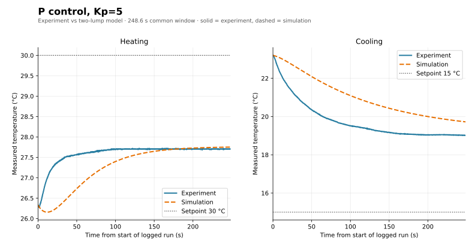
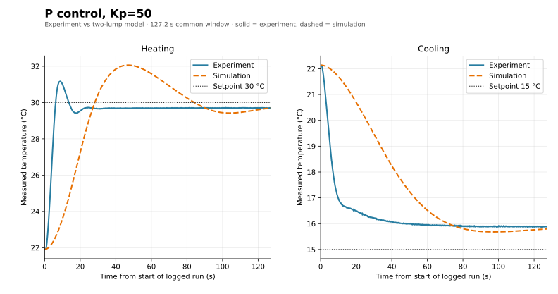
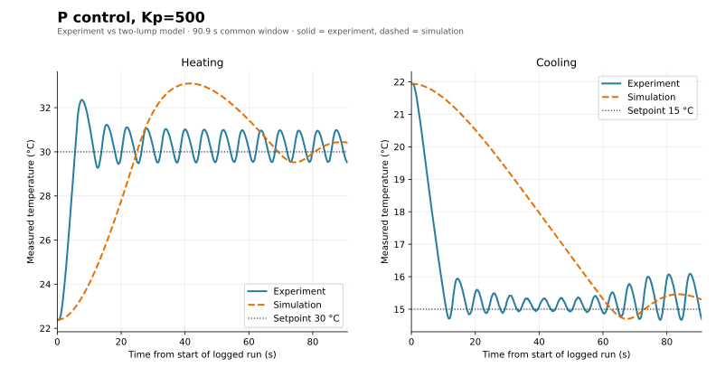
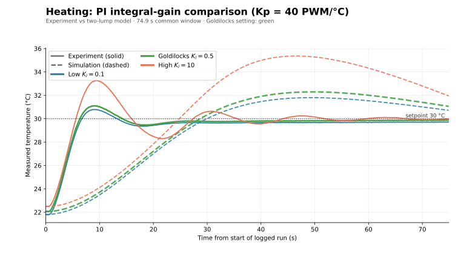
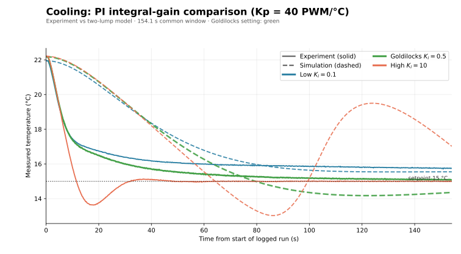

# Assignment 3: TEC feedback control

This analysis uses the Module 5 gain sweep and the Module 6 heating/cooling
logs and controller notes. PWM is signed in the plots: positive is heating and
negative is cooling.

## 1. One-lump energy balance and measured parameters

Treat the TEC and the measured thermal mass as one temperature $T$. The
energy balance is

$$
C\frac{dT}{dt}=P_u u-H(T-T_{\mathrm{amb}}),
$$

where $C$ is thermal capacitance ($\mathrm{J/K}$), $H$ is heat-loss conductance
($\mathrm{W/K}$), and $P_u$ is the direction-dependent thermal power per PWM count
($\mathrm{W/PWM}$). At steady state, the plant susceptibility is
$\chi_T=P_u/H$, in $^{\circ}\mathrm{C/PWM}$. Module 5 reports
$\chi_{T,h}=0.516$ and $\chi_{T,c}=0.137$; the Module 6 notes use
$0.515$ and $0.135$, respectively. These are consistent to the precision
expected from separate measurements.

The Module 6 README records $T_{63}=35.7\,^{\circ}\mathrm{C}$ and a measured
$\tau=49.8\,\mathrm{s}$. It separately documents a simulation with
$\tau=200\,\mathrm{s}$, $T_{\mathrm{amb}}=22\,^{\circ}\mathrm{C}$, and
$\Delta t=0.1\,\mathrm{s}$. These are different parameter sets: the $200\,\mathrm{s}$
value is the README's simulation assumption, not the measured apparatus
time constant.

For the simulation comparisons below, I use the README's
$\chi_{T,h}=0.515$, $\chi_{T,c}=0.135$, and $\tau=200\,\mathrm{s}$.
Applying the README's TEC electrical assumptions ($V=10\,\mathrm{V}$,
$R=1.50\,\Omega$, full scale $255$ PWM) gives the following internally
consistent one-lump parameters:

$$
\begin{aligned}
r &= \frac{\chi_{T,h}}{\chi_{T,c}}=3.815,\\
P_{u,c} &= 0.0929\,\mathrm{W/PWM},\\
P_{u,h} &= rP_{u,c}=0.3543\,\mathrm{W/PWM},\\
H &= \frac{P_{u,c}}{\chi_{T,c}}=0.688\,\mathrm{W/K},\\
C &= H\tau=137.6\,\mathrm{J/K}.
\end{aligned}
$$

| Parameter | Value | Unit |
| --- | ---: | --- |
| Heating/cooling coefficient ratio, r | 3.815 | dimensionless |
| Cooling coefficient, Pu,c | 0.0929 | W/PWM |
| Heating coefficient, Pu,h | 0.3543 | W/PWM |
| Heat-loss conductance, H | 0.688 | W/K |
| Total capacitance, C | 137.6 | J/K |

With proportional control, $u=K_p e$, where $e=T_{\mathrm{set}}-T$. Solving
the steady-state balance gives

$$
e_{\mathrm{ss}}=\frac{T_{\mathrm{set}}-T_{\mathrm{amb}}}{1+\chi_T K_p},
\qquad L=\chi_T K_p.
$$

$L$ is the dimensionless loop gain. Increasing $K_p$ reduces the
steady-state error, but increases sensitivity to delays, actuator limits, and
measurement noise. The heating loop gain is $L=\chi_{T,h}K_p$. Module 5's
measured heating sweep used $T_{\mathrm{amb}}=21.42\,^{\circ}\mathrm{C}$ and
$T_{\mathrm{set}}=30\,^{\circ}\mathrm{C}$ and agrees with this model:

| Kp (PWM/°C) | Loop gain | Predicted droop (°C) | Measured droop (°C) |
| ---: | ---: | ---: | ---: |
| 1.0 | 0.516 | 5.66 | 6.07 |
| 1.5 | 0.774 | 4.84 | 4.99 |
| 2.0 | 1.032 | 4.22 | 4.27 |
| 3.0 | 1.548 | 3.37 | 3.46 |
| 5.0 | 2.580 | 2.40 | 2.30 |

The measured and predicted droops differ by at most about $0.4\,^{\circ}\mathrm{C}$
in this sweep. The Module 5 initial heating error was $8.58\,^{\circ}\mathrm{C}$.
The feed-forward PWM needed to offset that error at steady state is
$$
u_{\mathrm{ff}}=\frac{8.58\,^{\circ}\mathrm{C}}{0.516\,^{\circ}\mathrm{C/PWM}}\approx16.63\,\mathrm{PWM}.
$$
This explains why the low-gain runs retained substantial droop.

For a first-order plant, proportional feedback also shortens the ideal
time constant according to $\tau_{\mathrm{cl}}=\tau/(1+\chi_T K_p)$.
Using the measured $\tau=49.8\,\mathrm{s}$, for example, $K_p=5$ gives
$\tau_{\mathrm{cl}}\approx13.9\,\mathrm{s}$ in heating and $29.6\,\mathrm{s}$ in
cooling. These are ideal linear estimates; the measured response is slower
when the PWM saturates or the thermistor/TEC coupling adds lag.

## 2. Experimental comparisons and the Goldilocks gain

The settings below are the three P gains and three PI integral gains in the
Module 6 README. The P figures compare heating and cooling for each P gain.
The PI results are regrouped by direction so the low, medium (recommended),
and high integral gains can be compared directly in one heating plot and one
cooling plot. Solid curves are measured temperatures; dashed curves are
two-lump simulations. For each setting, the simulation starts at the first
measured temperature in the corresponding logged segment. Curves within each
figure are cropped to a common duration.

The logged P-only runs are stored as PI-mode records with $K_i=0$; the
comparison generator selects those recorded runs from sessions 5 and 6.

| Setting | Heating start (°C) | Cooling start (°C) | Shared window (s) |
| --- | ---: | ---: | ---: |
| P, Kp = 5 | 26.33 | 23.20 | 248.6 |
| P, Kp = 50 | 21.91 | 22.14 | 127.2 |
| P, Kp = 500 | 22.39 | 21.94 | 90.9 |
| PI, Kp = 40, Ki = 0.1 | 21.81 | 21.95 | 74.9 |
| PI, Kp = 40, Ki = 0.5 | 22.06 | 22.18 | 120.1 |
| PI, Kp = 40, Ki = 10 | 22.49 | 22.21 | 154.1 |

The README describes the runs as starting at $22\,^{\circ}\mathrm{C}$, but the
logged $K_p=5$ heating segment starts at $26.33\,^{\circ}\mathrm{C}$. The other
starts are close to, but not exactly, $22\,^{\circ}\mathrm{C}$. The plots therefore
use the actual logged starts rather than silently treating all experimental
runs as identical initial conditions. Setpoints and controller settings are
matched by direction and run; the simulation uses the same measured start for
each comparison.

The proportional loop gains for the settings are summarized below. For PI,
these values describe only the proportional part; the integral term adds
frequency-dependent gain.

$$
\begin{aligned}
\mathrm{P},\ K_p=5 &: \quad (L_h,L_c)=(2.58,0.675),\\
\mathrm{P},\ K_p=50 &: \quad (L_h,L_c)=(25.75,6.75),\\
\mathrm{P},\ K_p=500 &: \quad (L_h,L_c)=(257.5,67.5),\\
\mathrm{PI},\ K_p=40 &: \quad (L_h,L_c)=(20.6,5.4),
\quad K_i\in\{0.1,0.5,10\}.
\end{aligned}
$$

### P control: heating and cooling by proportional gain

### PI control: compare integral gains by direction

The three gains are $K_i=0.1$ (low), $K_i=0.5$ (medium, the recommended
Goldilocks value), and $K_i=10$ (high), with $K_p=40$ fixed. Color
identifies the gain; solid/dashed line style identifies experiment/simulation.
The medium-gain trace is emphasized in green.

### Where the simulation data came from

The solid traces come from the Arduino/logger measurements stored in
[`data/temperature_log.csv`](data/temperature_log.csv); the plotting script
selects the longest contiguous matching block for each setting in heating
session 5 or cooling session 6. The dashed traces are **not another measured
dataset** and are not loaded from a simulation CSV. They are generated in
memory by [`Python/plot_a3_goldilocks.py`](Python/plot_a3_goldilocks.py) using
the two-lump equations and forward-Euler time stepping documented below. The
script reproduces the model's conditional-integration anti-windup behavior
from [`Python/Lab_6_7_modeling_tec_v3.py`](Python/Lab_6_7_modeling_tec_v3.py),
with the report's comparison parameters ($\tau=200\,\mathrm{s}$,
$\Delta t=0.1\,\mathrm{s}$, measured susceptibility ratio, $G=2.0$,
and PWM limit $\pm255$). Each run uses its own logged initial temperature,
setpoint, and PI gains. The README's example simulated run mentions fixed
$u=100$ PWM, but these plots instead re-run the closed-loop PI model with
the experimental gains; they are not copied from that fixed-input example.
The SVGs in `data/A3_comparison/` are rendered outputs of the comparison
script. These are model predictions—not hardware measurements—and their
differences from the solid traces show model mismatch.

The largest-gain runs show the tradeoff especially clearly. The table reports
the mean temperature over the final $60\,\mathrm{s}$ of each logged segment,
the largest excursion past setpoint, and the fraction of samples at the
$255$-count PWM limit.

| Controller | Direction | Run duration (s) | Final 60 s mean (°C) | Largest excursion | PWM at limit |
| --- | --- | ---: | ---: | ---: | ---: |
| P, Kp = 500 | Heating | 123.1 | 30.31 | 2.36 °C above setpoint | 48.9% |
| P, Kp = 500 | Cooling | 90.9 | 15.24 | 0.33 °C below setpoint | 28.6% |
| PI, Kp = 40, Ki = 10 | Heating | 188.5 | 30.00 | 3.27 °C above setpoint | 1.2% |
| PI, Kp = 40, Ki = 10 | Cooling | 154.1 | 15.00 | 1.37 °C below setpoint | 4.9% |

The high-gain P runs hit the PWM limit frequently, as the README describes.
PI at $K_i=10$ removes most steady-state error but produces a larger
temperature excursion. The final-window means are not peak temperatures:
they show that a run can finish close to setpoint after overshooting earlier.

## 3. Common-parameter simulation and comparison

The PI simulation comparisons use one common two-lump thermal plant. The
thermal dynamics are

$$
C_T\frac{dT}{dt}=P_u u-G(T-T_m),\qquad
C_m\frac{dT_m}{dt}=G(T-T_m)-H(T_m-T_{\mathrm{amb}}),
$$

with the controller measuring $T_m$. The model parameters are
$C=137.6\,\mathrm{J/K}$, $C_T/C=0.35$, $C_T=48.2\,\mathrm{J/K}$,
$C_m=89.4\,\mathrm{J/K}$, $G=2.0\,\mathrm{W/K}$, $H=0.688\,\mathrm{W/K}$,
$P_{u,c}=0.0929\,\mathrm{W/PWM}$, $r=3.815$, ambient $22\,^{\circ}\mathrm{C}$,
$\Delta t=0.1\,\mathrm{s}$, and a $\pm255$ PWM limit. Only controller
settings, setpoint/direction, and the per-run initial measured temperature
change between plots. The same parameters are used for all six cases.

The overlays should be read as a model comparison, not as a claim of a perfect
fit. In particular, the Module 6 README also gives a measured apparatus
$\tau=49.8\,\mathrm{s}$, while its example simulation uses $200\,\mathrm{s}$.
The comparisons intentionally reproduce that documented 200 s simulation
assumption; this longer modeled time scale contributes to differences in
response speed. A two-lump model also represents the thermistor's lag behind
the TEC, while a one-lump model cannot. Remaining differences can result from
changing ambient conditions, imperfect sensor/TEC coupling, PWM quantization,
and actuator saturation. The current v3 source defaults to a different
parameter set ($\tau=80\,\mathrm{s}$, heating/cooling ratio $2$); these plots
use the README's documented $\tau=200\,\mathrm{s}$ simulation assumption and
measured susceptibility ratio instead of mixing those presets.

## 4. Integral action, reset, windup, and anti-windup

For PI control, the requested command is

$$
u^*(t)=K_p e(t)+K_i I(t),\qquad
\frac{dI}{dt}=e,\qquad e=T_{\mathrm{set}}-T_{\mathrm{measured}}.
$$

In the discrete model, the integral update and saturated command are

$$
I_{k+1}=I_k+e_k\,\Delta t,
\qquad
u_k=\operatorname{clamp}(u_k^*,-255,255).
$$

The integral term accumulates
past error and can supply the extra PWM needed to remove P-control droop.
Each newly initialized model state starts with $I=0$; the model also clears
the integral state when switched to P control.

Windup occurs if error continues to accumulate in the same direction while
the output is already clamped. When the temperature finally approaches the
setpoint, the stored integral can keep commanding excessive output, causing
overshoot and slow recovery. The Module 6 model's conditional-integration
anti-windup rule proposes the next integral update but holds it if that update
would drive an already saturated command farther beyond the limit. It still
allows the integral to unwind when the error reverses. This is consistent with
the logged high-$K_i$ runs: the integrator reduces final error, but faster
accumulation increases overshoot risk.

## 5. Two-lump stability, model comparison, and gain choice

The two-lump model distinguishes the TEC-side temperature $T$ from the
measured thermal mass/thermistor temperature $T_m$. Heat must flow through
the coupling $G$ before the sensor responds. This delay explains why a
controller can continue heating or cooling after the TEC itself has begun to
move toward setpoint; the one-lump model assumes $T=T_m$ and misses that
effect.

For P control in one lump, the closed-loop pole is
$$
s=-\frac{H+P_u K_p}{C},
$$
which is stable for positive $C,H,P_u,K_p$ in this idealized continuous-time
model. For two-lump P control, the characteristic polynomial is
$$
s^2+s\left(\frac{G}{C_T}+\frac{G+H}{C_m}\right)
+\frac{G(H+P_u K_p)}{C_T C_m}=0.
$$
Its coefficients are positive for positive physical parameters and gain, so
both poles have negative real parts. This criterion excludes sensor delay,
PWM limits, quantization, and nonlinear TEC behavior. For a discrete
one-pole Euler model, stability additionally requires
$0<\Delta t/\tau_{\mathrm{cl}}<2$; a ratio no greater than $1$ avoids alternating
sample-to-sample error in that simplified case.

For PI control, the one-lump damping ratio is
$$
\zeta=\frac{H+P_u K_p}{2\sqrt{C P_u K_i}}.
$$
Larger $K_i$ lowers damping. In the two-lump model, let
$a=G/C_T+(G+H)/C_m$ and $q=P_u$ for the direction being tested. The
linearized cubic PI characteristic is stable under the Routh condition
$$
q K_i<a(H+q K_p).
$$
With the common simulation parameters above and $K_p=40$, this predicts
that $K_i=0.1$ and $0.5$ satisfy the condition in both directions, whereas
$K_i=10$ does not. Saturation and anti-windup change the nonlinear response,
but the criterion explains why the largest integral gain is the least robust
choice.

I would use **PI $K_p=40,\ K_i=0.5$** as the final compromise. The Module 6
README reports small final errors for this setting in both directions
(approximately $0.15\,^{\circ}\mathrm{C}$ heating and $0.2\,^{\circ}\mathrm{C}$
cooling), without the larger overshoot reported at $K_i=10$. $K_i=0.1$
is a conservative alternative if overshoot matters more than settling error;
$K_i=10$ is not recommended because it raises overshoot and fails the
linearized two-lump PI stability check for these parameters. Keep
anti-windup enabled and verify behavior at the actual PWM limits before
increasing either gain.

## Sources

- [Module 5 README](../Module%205/README.md) and [Module 5 gain-tuning data](../Module%205/data/gain_tuning_droop.csv)
- [Module 6 README](README.md), [Module 6 temperature log](data/temperature_log.csv), [two-lump model](Python/Lab_6_7_modeling_tec_v3.py), and [A3 plot-generation script](Python/plot_a3_goldilocks.py)
