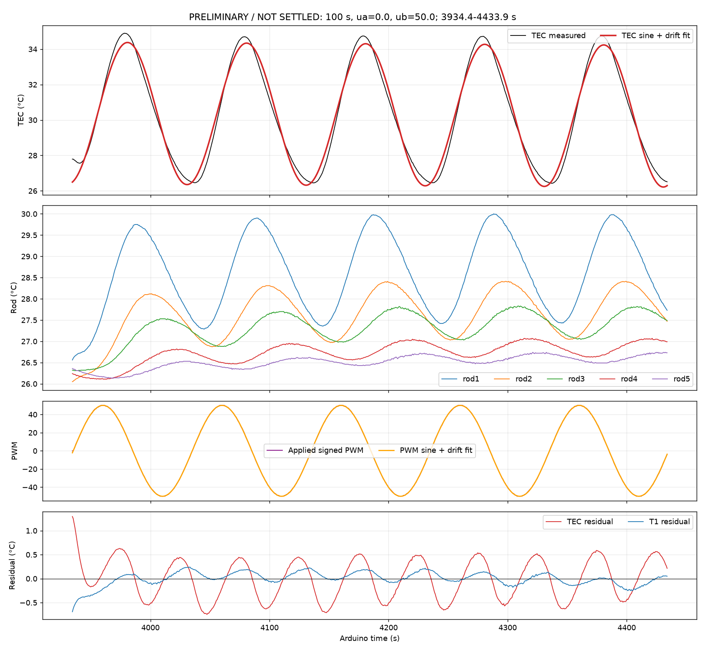
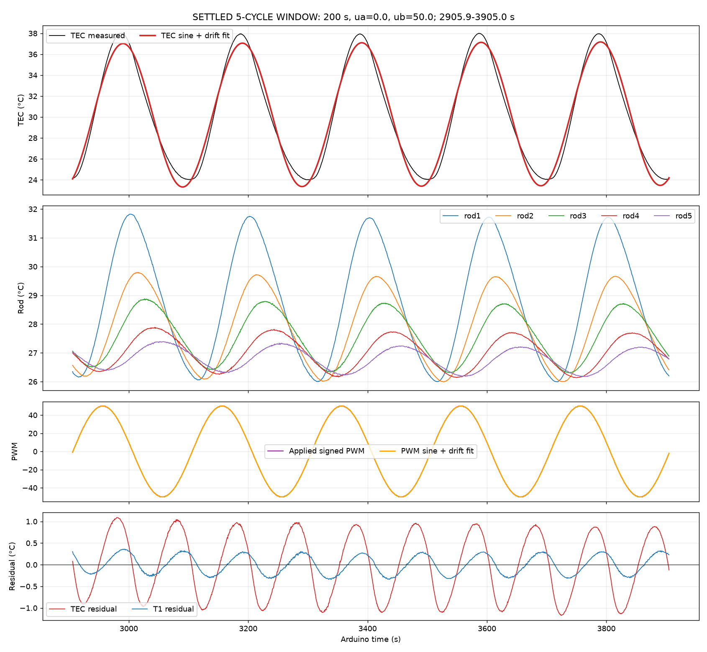
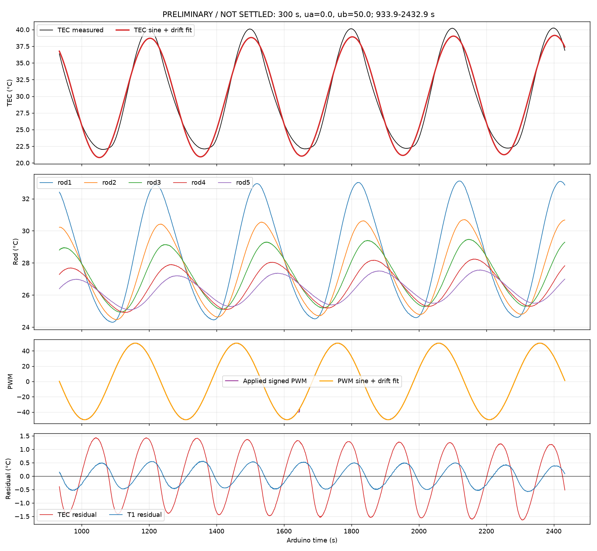
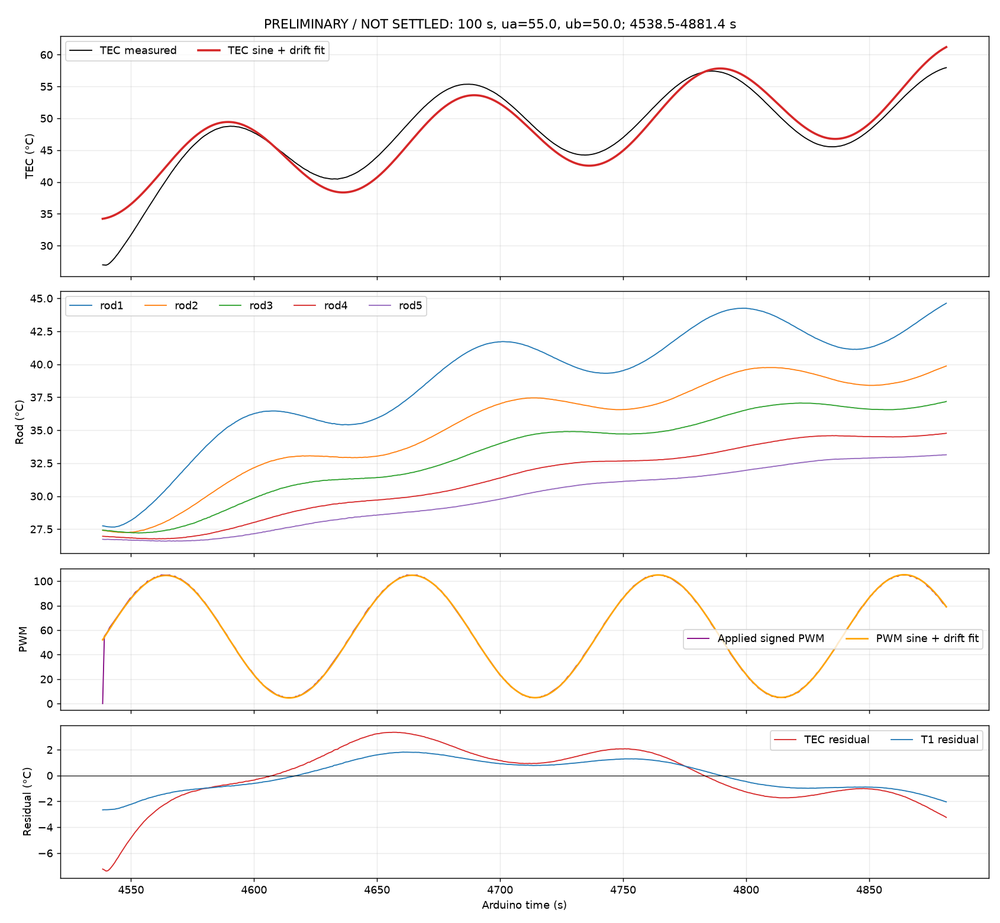
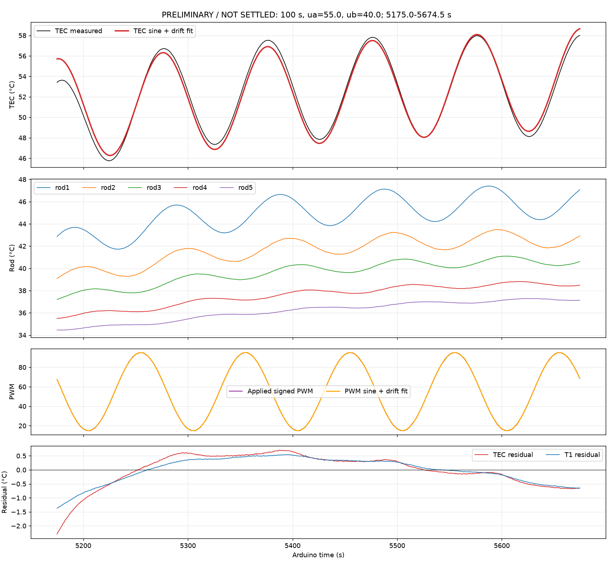

# S18 Results and Data Check — 2026-11-19

This note summarizes the Module 8 files available on 2026-11-19. The
experimenter reports room temperature was approximately 22.4 °C; this is an
estimate, not a calibrated measurement. Keep the original raw CSV unchanged.

## Run coverage

The paired recording is:

- `data/raw_mod8_20261119_102636.csv`
- `data/pi_log_mod8_20261119_102636.csv`

The PI log contains the segment settings, segment identifiers, observed signed
PWM, and safety state, so it can be joined to the raw temperature record.

| Drive | Recorded result | Assessment |
|---|---|---|
| Zero-centered, 300 s, `ua=0`, `ub=50` | 7.5 periods recorded. Temperatures remained below the 56 °C rod-base limit and the logged safety state remained OK. | Not enough settled data: only the last adjacent cycle pair met the per-cycle checks. |
| Zero-centered, 200 s, `ua=0`, `ub=50` | About 7.1 periods recorded. | Usable settled window: five consecutive cycles from 2905.86 to 3904.98 s pass the cycle-to-cycle checks across the rod sensors. |
| Zero-centered, 100 s, `ua=0`, `ub=50` | About 5.9 periods recorded. | Not settled: none of the complete-cycle comparisons met all checks. |
| Positive-only, 100 s, `ua=55`, `ub=50` | Interrupted segments; TEC approached 58 °C. | Not a settled comparison. Do not repeat these settings. |
| Positive-only, 100 s, `ua=55`, `ub=40` | About 5.5 periods; TEC reached about 58 °C, and temperatures were still drifting. | Not settled and too close to the TEC cutoff for repeating these settings. |

The Arduino logged safety as `OK` in the positive-only segments, but the
measured TEC temperature approached the 60 °C software cutoff. The logged
state does not make these settings safe to repeat. The earlier attempts also
do not establish a safe positive-only operating point.

## Settled 200 s zero-centered fit

The following values come from a least-squares fit over the five-cycle window
2905.86-3904.98 s. Temperature fits include a linear drift term as well as a
sinusoid. Phases for the rod sensors are relative to T1; TEC phase is relative
to the measured signed PWM.

| Channel | Fitted mean (°C) | Mean minus room (°C, approx.) | Fundamental amplitude (°C) | Phase lag |
|---|---:|---:|---:|---:|
| TEC | 30.24 | 7.84 | 6.86 | 61.1° behind PWM |
| T1 | 28.77 | 6.37 | 2.77 | Reference |
| T2 | 27.85 | 5.45 | 1.79 | 23.3° behind T1 |
| T3 | 27.57 | 5.17 | 1.18 | 45.7° behind T1 |
| T4 | 27.00 | 4.60 | 0.78 | 69.6° behind T1 |
| T5 | 26.78 | 4.38 | 0.51 | 91.6° behind T1 |

Applied PWM fit: mean approximately 0, amplitude 50.02 counts, extrema -50 to
+50. The rod amplitudes decrease and phase lags increase with distance, as
expected for a periodically heated rod. Mean-minus-room values inherit the
uncertainty in the approximate 22.4 °C room temperature.

## Preliminary measured fits for all available periods

The 100 s and 300 s fits below use five complete cycles each from their
continuous runs. They are exploratory sine-plus-drift fits, not settled-cycle
results; use them to describe trends, not as final settled measurements. The
200 s row uses the five-cycle settled interval above.

| Period (s) | Fit window (s) | Status | TEC mean (°C) | Mean minus room (°C, approx.) | TEC amplitude (°C) | TEC residual half peak-to-peak (°C) | Drift (°C/min) | TEC phase lag vs PWM |
|---:|---:|---|---:|---:|---:|---:|---:|---|
| 100 | 3934.43-4433.94 | Preliminary; not settled | 30.30 | 7.90 | 4.00 | 1.02 | -0.021 | 74.2° |
| 200 | 2905.86-3904.98 | Five settled cycles | 30.24 | 7.84 | 6.86 | 1.13 | +0.012 | 61.1° |
| 300 | 933.85-2432.93 | Preliminary; not settled | 29.95 | 7.55 | 8.92 | 1.54 | +0.021 | 52.3° |

Across these fits the TEC oscillation amplitude grows with period, consistent
with the one-lump thermal low-pass response. The measured TEC lag decreases
from 74.2° at 100 s to 61.1° at 200 s and 52.3° at 300 s, matching the model's
direction of change, though the 100 s and 300 s results are unsettled. At
200 s the measured TEC amplitude (6.86 °C) and 61.1° lag are between the
assignment model's unequal-susceptibility predictions (6.38 °C, 68.3°) and
equal-susceptibility predictions (8.50 °C, 68.3°). The measured mean rise and
residual are larger than the simple model predicts. Differences may reflect
the approximate room temperature, real actuator response, non-sinusoidal
PWM/thermal behavior, or limitations of the one-lump model. The unsettled
periods should not be used to claim a final model validation.

The three figures show the fitted windows and residuals. The 100 s and 300 s
plots are explicitly preliminary because their cycle-to-cycle settling checks
did not pass.

## One-lump model predictions

These are settled periodic predictions for zero-centered signed PWM with
`ub=50`, `chi_h=0.46 °C/PWM`, and `tau_th=80 s`. They use the S18.3 table's
`chi_c` values. At equal heating and cooling susceptibility, the settled mean
shift and nonsinusoidal residual vanish in this linear model.

| Period (s) | `chi_c` (°C/PWM) | Mean minus room (°C) | Fundamental amplitude (°C) | Phase lag | Residual half peak-to-peak (°C) |
|---:|---:|---:|---:|---:|---:|
| 100 | 0.23 | 3.66 | 3.37 | 78.7° | 0.24 |
| 100 | 0.46 | 0.00 | 4.49 | 78.7° | 0.00 |
| 200 | 0.23 | 3.66 | 6.38 | 68.3° | 0.47 |
| 200 | 0.46 | 0.00 | 8.50 | 68.3° | 0.00 |
| 300 | 0.23 | 3.66 | 8.84 | 59.1° | 0.70 |
| 300 | 0.46 | 0.00 | 11.79 | 59.1° | 0.00 |

For comparison, the measured 200 s TEC fit has mean-minus-room approximately
7.84 °C, amplitude 6.86 °C, and lag 61.1°. These are preliminary comparisons:
the model susceptibilities are the assignment values, and the measured room
temperature is approximate. Use measured susceptibilities and the measured
initial temperature if available for the final model-versus-experiment
comparison.

## Positive-only S18.4 data and model

The positive-only trials do not provide a settled comparison. The `ua=55`,
`ub=50` attempt lasted about 3.4 cycles in its longest continuous segment. The
later `ua=55`, `ub=40` segment lasted about 5.5 cycles; its latest five-cycle
fit still shows TEC drift of about +0.355 °C/min. TEC reached about 58 °C.
Do not treat either interval as settled or repeat those settings without
safety reassessment.

| `ua` (PWM) | `ub` (PWM) | Fit window (s) | Cycles | TEC mean (°C) | TEC amplitude (°C) | Residual half peak-to-peak (°C) | TEC drift (°C/min) | Status |
|---:|---:|---:|---:|---:|---:|---:|---:|---|
| 55 | 50 | 4538.48-4881.35 | 3.43 | 47.97 | 6.55 | 5.37 | +2.52 | Interrupted, strongly warming |
| 55 | 40 | 5174.97-5674.52 | 5.00 | 52.32 | 4.87 | 1.50 | +0.355 | Not settled, near cutoff |

For `ua=55`, the one-lump positive-only prediction uses heating susceptibility
`chi_h=0.46 °C/PWM`; the cooling susceptibility is irrelevant because the
requested waveform stays positive. The predicted mean is 47.7 °C at an
assumed 22.4 °C room, with a 78.7° lag and no modeled residual:

| `ua` (PWM) | `ub` (PWM) | Period (s) | Predicted mean (°C) | Fundamental amplitude (°C) | Phase lag | Residual half peak-to-peak (°C) |
|---:|---:|---:|---:|---:|---:|---:|
| 55 | 50 | 100 | 47.7 | 4.49 | 78.7° | 0.00 |
| 55 | 40 | 100 | 47.7 | 3.59 | 78.7° | 0.00 |

The `ub=40` positive-only attempt also differs from the zero-centered
100 s baseline (`ub=50`), so it is not the requested matched-amplitude
comparison. Because the measured run is still warming and approaches the TEC
cutoff, its fitted mean, amplitude, and residual cannot establish whether
positive-only PWM improved the settled temperature waveform.

## Remaining work

- Extend or repeat the 300 s and 100 s zero-centered runs until there are at
  least five consecutive settled cycles. Keep the rod-base temperature at or
  below 56 °C and leave margin below the TEC cutoff.
- Plan a new 100 s positive-only trial only after reviewing the near-cutoff
  history with the instructor/operator. Use a lower mean and/or amplitude; no
  safe numeric settings have been verified. Collect a full settled comparison
  only if temperatures remain comfortably safe.
- Complete the experimental and simulation tables and save the aligned plots
  once the required settled data are available.
- Document the common-bath check and resolve S18.2's combined serial-record
  requirement, if not already done separately.
